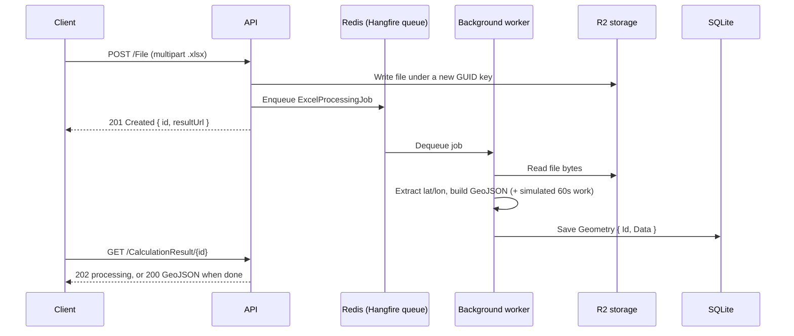

# WebApplication2

An ASP.NET Core 8 API that **simulates long-running calculation work**. Rather than making the client wait for a slow computation, the API accepts the work, immediately returns a **resource ID**, and lets the client poll that ID to find out whether the calculation is finished — and to fetch the result once it is.

The "calculation" is an Excel-to-GeoJSON conversion: an uploaded `.xlsx` file containing latitude/longitude columns is converted into a GeoJSON `FeatureCollection`. A deliberate one-minute delay stands in for the real heavy computation.

## Request lifecycle



1. `POST /File` — `FileController` streams the upload through `IFileStorage.Write` to Cloudflare R2 under a fresh GUID key, enqueues a Hangfire background job (`ExcelProcessingJob.Process(filePath)`), and returns immediately with the resource ID.
2. Worker — Hangfire (backed by Redis) picks up the job: `IFileStorage.Read` fetches the bytes, `ExtractCoordinates` reads the first worksheet using header cells containing `lat` and `lon`/`lng`, and `BuildGeoJson` produces a WGS84 (EPSG:4326) `FeatureCollection`. `await Task.Delay(60000)` simulates the long calculation.
3. Persist — the GeoJSON is stored as a `Geometry { Id = filePath, Data }` row in SQLite via EF Core.
4. Poll — the result endpoints check whether a `Geometry` row exists for the ID: absent means still processing, present means completed.

## API reference

| Method | Route | Result | Purpose |
|---|---|---|---|
| `POST` | `/File` | `201 Created` | Accepts a multipart upload (form field `file`) and returns the new resource ID. |
| `GET` | `/CalculationResult/{id}` | `200` GeoJSON / `202` JSON | Returns the finished result, or `202 Accepted` with `{ "status": "processing" }` while the job runs. |
| `GET` | `/CalculationResult/{id}/status` | `200` JSON | Lightweight poll: `{ "status": "processing" }` or `{ "status": "completed" }`. |
| `GET` | `/hangfire` | Dashboard | Background job dashboard: queues, retries, history. |

### Example

```bash
# Upload — returns the resource ID straight away
curl -k -i -F "file=@points.xlsx" https://localhost:7182/File
```

```json
{
  "id": "6b9f3c1e-0f5a-4d0e-9f2c-8b1d7a4e5c10",
  "resultUrl": "https://localhost:7182/CalculationResult/6b9f3c1e-0f5a-4d0e-9f2c-8b1d7a4e5c10"
}
```

```bash
# Poll until completed
curl -k https://localhost:7182/CalculationResult/6b9f3c1e-0f5a-4d0e-9f2c-8b1d7a4e5c10/status
# → { "status": "processing" }   ... later ...
# → { "status": "completed" }

# Fetch the result (application/geo+json)
curl -k https://localhost:7182/CalculationResult/6b9f3c1e-0f5a-4d0e-9f2c-8b1d7a4e5c10
```

The `id` is the storage key assigned when the file was written (a GUID) and serves as the resource ID for all polling.

### Expected input format

- Only the first worksheet is read.
- A header cell containing `lat` selects the latitude column; one containing `lon` or `lng` selects the longitude column (case-insensitive).
- Rows below the header with numeric values in both columns become GeoJSON points.
- If no such columns are found, the job logs a warning and returns without storing a result; the ID keeps reporting `processing`.

## Architecture

The goal of the structure is that the application core (endpoints and processing logic) knows nothing about Cloudflare R2, Redis, or SQLite — it only knows interfaces.

### Ports & Adapters (hexagonal architecture)

- **Port** — `Services/IFileStorage.cs` defines *what* the application needs: "a port for storing and retrieving files".
- **Adapter** — `Services/R2FileStorage.cs` implements *how*: Cloudflare R2 over the S3 API, and is explicitly documented as "the adapter for our `IFileStorage` port". `IAmazonS3` is itself another port, whose adapter is Amazon's `AmazonS3Client`, constructed once in the composition root.
- The controllers and the background job depend only on the port, never on the storage technology. Swapping R2 for local disk or another bucket service means writing one new adapter and changing a single DI registration in `Program.cs` — no changes in the core.

### Single Responsibility Principle

Every class has one reason to change:

| Class | Responsibility |
|---|---|
| `FileController` | HTTP upload handling and enqueueing the job — nothing else. |
| `CalculationResultController` | Answering result/status queries. |
| `ExcelProcessingJob` | The processing pipeline: read → extract → build GeoJSON → persist. |
| `R2FileStorage` | Translating the storage port into S3 calls. |
| `ApplicationDbContext` | Persistence mapping only. |
| `R2Options` | The shape of the R2 configuration section. |

### Dependency inversion

- High-level policy (controllers, job) depends on **abstractions** — `IFileStorage`, `ApplicationDbContext`, `ILogger<T>`, `IOptions<R2Options>` — all supplied through constructor injection. Nothing is `new`-ed up inside business code.
- Low-level details (the S3 client, Redis-backed Hangfire, SQLite) are constructed in the composition root, `Program.cs`, and wired via the DI container.
- `R2FileStorage` depends on the `IAmazonS3` interface rather than `AmazonS3Client`, so even the adapter depends on an abstraction.
- The result: dependencies point inward toward the interfaces, and the core can be unit-tested or re-hosted with different infrastructure without modification.

## Project layout

```
WebApplication2/
├── Controllers/
│   ├── FileController.cs              # upload → storage → enqueue → 201 with resource ID
│   └── CalculationResultController.cs # result / status polling
├── Services/
│   ├── IFileStorage.cs                # the storage port
│   └── R2FileStorage.cs               # R2 (S3 API) adapter
├── Jobs/
│   └── ExcelProcessingJob.cs          # background job + simulated 60s calculation
├── Entities/
│   └── Geometry.cs                    # Id + GeoJSON payload
├── DbContexts/
│   └── ApplicationDbContext.cs        # EF Core / SQLite
├── Migrations/                        # applied automatically on startup
├── Models/
│   ├── CalculationResultDto.cs
│   └── Options/R2Options.cs           # configuration shape for R2
└── Program.cs                         # composition root: DI, Hangfire, EF, Swagger
```

## Configuration

| Setting | Used for | Default |
|---|---|---|
| `R2:AccountId`, `R2:AccessKeyId`, `R2:SecretAccessKey`, `R2:BucketName` | Cloudflare R2 (S3-compatible) object storage | empty — must be supplied |
| `ConnectionStrings:Redis` | Hangfire job storage | `localhost:6379` |
| `ConnectionStrings:DefaultConnection` | Application data (SQLite) | `Data Source=app.db` |

Secrets are never committed. For local development use .NET user secrets (stored outside the repository):

```bash
cd WebApplication2
dotnet user-secrets init
dotnet user-secrets set "R2:AccountId" "<account-id>"
dotnet user-secrets set "R2:AccessKeyId" "<key-id>"
dotnet user-secrets set "R2:SecretAccessKey" "<secret>"
dotnet user-secrets set "R2:BucketName" "<bucket>"
```

In containers, pass the same keys as environment variables using the standard double-underscore mapping: `R2__AccountId`, `R2__AccessKeyId`, `R2__SecretAccessKey`, `R2__BucketName`.

## Running locally

Prerequisites: .NET 8 SDK, Docker (for Redis), and R2 credentials.

```bash
# 1. Start Redis (Hangfire storage)
docker compose up -d redis

# 2. Configure R2 credentials (see Configuration above)

# 3. Run the API
dotnet run --project WebApplication2
```

- Swagger UI (Development): `https://localhost:7182/swagger` or `http://localhost:5043/swagger`
- EF Core migrations are applied automatically at startup; the SQLite database (`WebApplication2/app.db`) is created on first run and is git-ignored.

### Docker

```bash
docker compose up --build
```

This builds the API image and starts Redis. Provide the R2 settings to the `webapplication2` service as environment variables (e.g. via an `environment:` block or a git-ignored `.env` file).

## Tech stack

- .NET 8 / ASP.NET Core Web API, Swashbuckle (Swagger/OpenAPI)
- Hangfire + Redis — background job queue and dashboard
- EF Core + SQLite — result persistence, migrations
- AWSSDK.S3 — Cloudflare R2 access
- ClosedXML — Excel parsing; NetTopologySuite + GeoJSON4STJ — GeoJSON output
