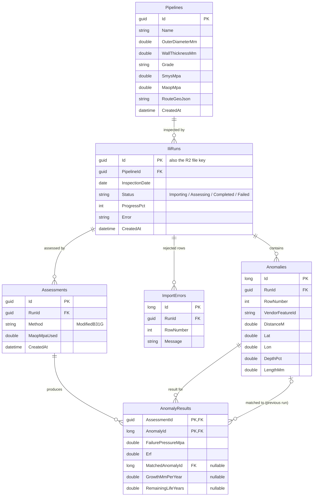
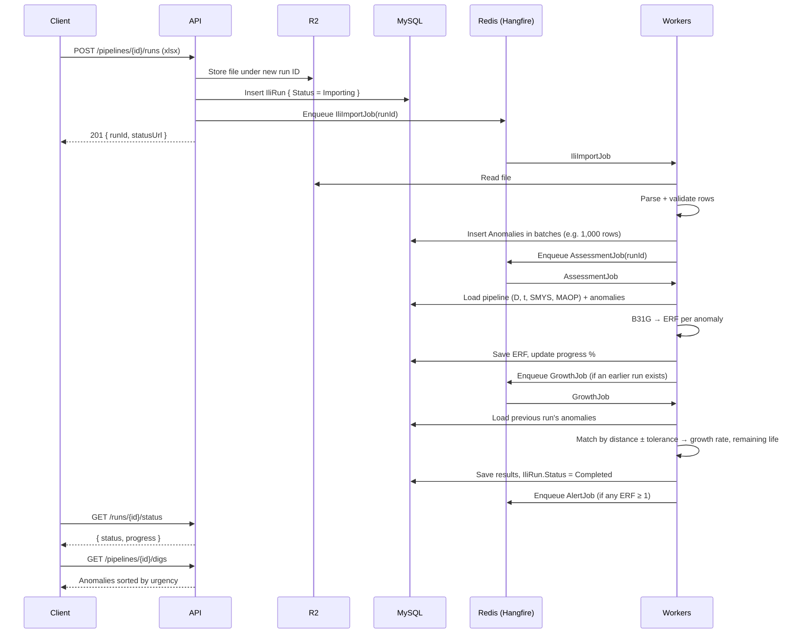
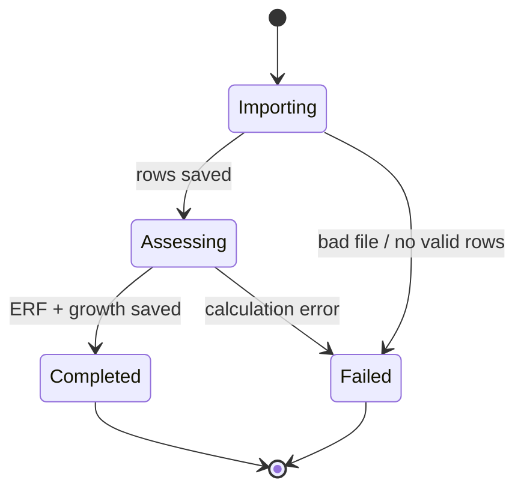
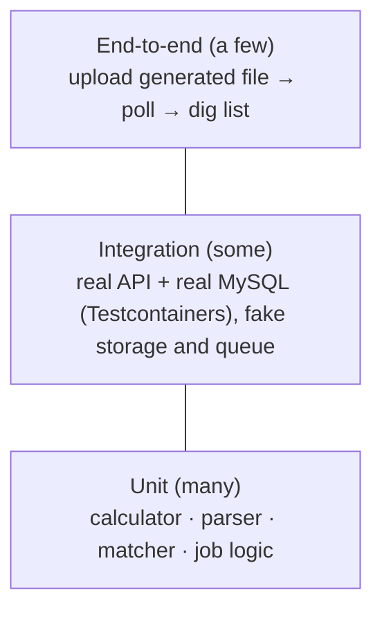
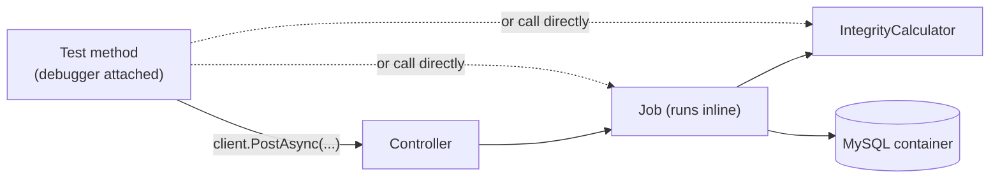

# Study project: Pipeline Integrity API

The next thing we build on top of this API. It takes the upload → background job → poll → GeoJSON flow we already have and puts a real engineering problem inside it, in place of the fake 60-second delay.

## The problem in plain terms

Oil and gas travel through steel pipes that run for hundreds of kilometres. Over time the steel **corrodes**, and pits form where the wall gets thinner. A thin spot can burst if the pressure inside is too high.

To find these spots, operators send a robot called a **pig** through the pipe. It measures the wall as it goes. The inspection company then sends back a spreadsheet with one row per defect (an **anomaly**):

| Column | Meaning |
|---|---|
| `distance_m` | How far along the pipe the defect is (also called *chainage*) |
| `lat`, `lon` | Where it is on the map |
| `depth_pct` | How deep the pit is, as a % of the wall thickness |
| `length_mm` | How long the pit is along the pipe |

An engineer needs answers to three questions:

1. **Is this defect dangerous right now?**
2. **How fast is it getting worse?**
3. **When must we dig it up and repair it?**

Our API answers them automatically for every defect in the file.

## Words you'll see

| Term | Meaning |
|---|---|
| **OD** (`D`) | Outside diameter of the pipe, in mm |
| **WT** (`t`) | Wall thickness, in mm |
| **SMYS** | How strong the steel is (Specified Minimum Yield Strength), in MPa. Comes from the steel grade, e.g. X52 = 359 MPa, X65 = 448 MPa |
| **MAOP** | The highest pressure the pipe is allowed to run at (Maximum Allowable Operating Pressure), in MPa |
| **ILI run** | One pass of the pig, i.e. one uploaded spreadsheet |
| **ERF** | Estimated Repair Factor. A score where **≥ 1 means "repair needed"** |

## The maths (just functions, no engineering background needed)

We use **Modified ASME B31G**, an industry-standard formula. Given a pipe (`D`, `t`, `SMYS`) and a defect (depth `d` in mm, length `L` in mm):

```
flowStress = SMYS + 69                              // MPa
z          = L² / (D · t)
M          = z <= 50 ? sqrt(1 + 0.6275·z − 0.003375·z²)
                     : 0.032·z + 3.3                // "bulging factor"
failStress = flowStress · (1 − 0.85·d/t) / (1 − 0.85·(d/t) / M)
failPressure = 2 · failStress · t / D              // pressure that bursts the pipe
safePressure = failPressure · 0.72                  // design factor (0.72 = Class 1 location; simplified)
ERF          = MAOP / safePressure                  // ≥ 1 → repair
```

When we have **two ILI runs** of the same pipe, a few years apart:

```
growthRate    = (depthNow − depthBefore) / yearsBetween      // mm per year
remainingLife = (0.8·t − depthNow) / growthRate              // years until 80% wall loss
```

> Unit test these first. They are pure functions with no database and no HTTP, so they're the easiest place to start.

## What we'll build

**Entities:** `Pipeline` (D, t, grade, MAOP, route) → `IliRun` (date, file, status) → `Anomaly` (distance, location, depth, length, ERF, growth rate, remaining life).

| Method | Route | Does |
|---|---|---|
| `POST` | `/pipelines` | Register a pipeline and its properties |
| `POST` | `/pipelines/{id}/runs` | Upload an ILI spreadsheet. Returns a run ID straight away (like today's `/File`) |
| `GET` | `/runs/{id}/status` | Poll: processing / completed / failed |
| `GET` | `/pipelines/{id}/anomalies?minErf=1&fromM=&toM=` | Filter defects by danger level or by stretch of pipe |
| `GET` | `/pipelines/{id}/anomalies.geojson?bbox=` | Defects as a GeoJSON map layer |
| `GET` | `/pipelines/{id}/digs` | Repair list, sorted by most urgent |

## Database design

### Tables



| Milestone | Tables added |
|---|---|
| 1 | `Pipelines`, `IliRuns`, `Anomalies`, `ImportErrors` |
| 2 | `Assessments`, `AnomalyResults` (ERF only) |
| 4 | The growth columns on `AnomalyResults` |
| 5 | `AuditLog` (`Id, At, User, Action, EntityId, Details`), append-only |

### Guidelines

1. **Keep inputs and results separate.** `Anomalies` holds exactly what the file said and is never updated. Calculated values go in `AnomalyResults`. If the formula has a bug, or the MAOP changes, you create a new `Assessment` and old results are kept. Overwriting would erase the history that regulators ask for.
2. **Put the unit in the column name**: `WallThicknessMm`, `MaopMpa`, `DistanceM`. Unit mix-ups (mm vs inches, MPa vs psi) are a classic engineering bug, and a name like `Thickness` hides them.
3. **Store values that are copied at the time.** `Assessments.MaopMpaUsed` records the MAOP the calculation actually used. If someone edits the pipeline later, the old result still makes sense.
4. **Use foreign keys everywhere** and let the database enforce them. Deleting a run should cascade to its anomalies, errors and assessments.
5. **Index what you filter and sort on.** Add each index when an endpoint needs it, and say which query it serves:
   - `Anomalies (RunId, DistanceM)`: chainage-range queries, and matching between runs
   - `AnomalyResults (AssessmentId, Erf DESC)`: the dig list
   - `IliRuns (PipelineId, InspectionDate)`: "find the previous run"
6. **Pick key types on purpose.** Use GUIDs for things clients see and share (pipelines, runs). They're safe to expose and work as storage keys, as today. Use auto-increment `long` for the large internal tables (anomalies), because the keys are smaller and inserts are faster. In MySQL, the Pomelo provider stores a `Guid` as `char(36)` by default.
7. **Record bad rows instead of failing the whole file.** One bad row out of 50,000 goes into `ImportErrors` with its row number. Fail the run only if no rows are valid, or if more than a set threshold are bad.
8. **Store status as text, not a number.** `"Completed"` is readable when you open the database by hand. In EF Core, use `.HasConversion<string>()`.
9. **`double` is fine here.** Unlike money, engineering values are already measurements with error. Round only when displaying.
10. **Insert in batches.** Don't call `SaveChanges()` once per row: 50,000 round trips is slow. Add about 1,000 rows, save, clear the change tracker, and repeat.

## System architecture

The same building blocks as today's API, with new jobs and a pure calculation module added. Arrows point from the caller to what it depends on.


**Rules to keep the design clean:**

- **Controllers stay thin.** They validate the request, save a row, enqueue a job and return. They never do the maths.
- **The calculator is pure.** No database, no HTTP, no files: numbers in, numbers out. That makes it easy to unit test, and it's the code that has to be right.
- **Jobs coordinate the work.** They load data through the ports, call the calculator, and save the results.
- **Each job does one step and then enqueues the next.** If one step fails, you can see where in the Hangfire dashboard.

## Data flow

What happens from upload to results, for one ILI run:



The run's status moves through these states:



Each failure stores an error message, just like `Geometry.Status = Failed` does today.

## Milestones, and what each one teaches

| # | Build | Backend concept you learn |
|---|---|---|
| 1 | Pipelines + ILI upload, reusing `ExcelProcessingJob` and `IFileStorage` | Relational modelling, foreign keys, input validation with per-row error messages |
| 2 | B31G assessment job (replace `Task.Delay` with the real maths) | Background jobs doing real CPU work, batching large files, progress reporting, unit testing pure logic |
| 3 | Filtering, paging, GeoJSON map endpoint | Query design, pagination, database indexes, spatial queries |
| 4 | Compare two runs → growth rate + remaining life | Matching records between datasets (match by `distance_m` ± tolerance), keeping old results instead of overwriting them |
| 5 | Alert when ERF ≥ 1, audit log, user roles | Webhooks with retries, append-only logs, authentication and authorisation |

## Testing plan

This plan follows two books:

- **Gerard Meszaros, *xUnit Test Patterns*** ("xUnit" here means the whole family of test frameworks, MSTest included): gives names for the parts of a test, the kinds of test double, and "test smells".
- **Roy Osherove, *The Art of Unit Testing*:** what a *unit of work* is, how to name tests, stubs vs mocks, and keeping unit and integration tests apart.

### Key ideas (one line each)

| Idea | From | What it means for us |
|---|---|---|
| **SUT** (system under test) | Meszaros | The one thing a test is about. Everything else is setup. |
| **Four-phase test**: setup → exercise → verify → teardown | Meszaros | Write it as **Arrange / Act / Assert** blocks (the same idea under Bill Wake's widely used name, which Osherove uses too). Teardown is usually automatic. |
| **Unit of work** | Osherove | A unit is not "one method". It's everything that runs from one entry point to one *exit point*. |
| **Three exit points**: a return value, a state change, or a call to a third party | Osherove | Check return values and state directly. Only a call to a third party needs a mock. |
| **Test doubles**: dummy, stub, spy, mock, fake | Meszaros | See the table below. Use the precise name, not just "mock". |
| **Stub vs mock** | Osherove | A stub *feeds data in* and you never assert on it. A mock *checks what went out*. Use **at most one mock per test**. |
| **Humble Object** | Meszaros | Move logic out of things that are hard to test (controllers, Hangfire jobs) into plain classes. The hard-to-test part becomes so thin it barely needs a test. |
| **Fresh fixture** | Meszaros | Each test builds its own data. Tests that share mutable data fail at random. |
| **Readable, maintainable, trustworthy** | Osherove | No `if`s or loops in tests. Don't assert on implementation details. A failing test should point at the bug. |
| **Safe green zone** | Osherove | Keep unit tests (fast, always pass) in a different project from integration tests (slower, need setup). |

**Naming** (Osherove): `UnitOfWork_Scenario_ExpectedBehaviour`, e.g. `CalculateErf_DefectDeeperThanLimit_ReturnsAtLeastOne`.

### The test pyramid for this project



### Design for testability first

Tests need **seams**: places where a test can plug in a double. Two seams to add before writing tests:

1. **Queue seam.** `FileController` calls the static `BackgroundJob.Enqueue(...)`, which a test can't replace. Inject Hangfire's `IBackgroundJobClient` instead and call `_jobs.Enqueue(...)`.
2. **Humble jobs.** `AssessmentJob.Run(runId)` should only *load → call the calculator → save*. Put the maths in `IntegrityCalculator`, the spreadsheet parsing in `IliRowParser`, and run-to-run matching in `AnomalyMatcher`. All three are plain classes with no dependencies. (And remove the `Task.Delay(60000)` 🙂)

### Test doubles we'll use

| Double | Meszaros definition | In this project |
|---|---|---|
| **Dummy** | Passed in but never used | `NullLogger<T>.Instance` |
| **Stub** | Returns canned answers | `IFileStorage` stub that returns the bytes of a generated `.xlsx` |
| **Fake** | Works, but takes a shortcut | `InMemoryFileStorage` (a dictionary) in place of R2 |
| **Spy** | Records the calls it receives, for checking later | `RecordingJobClient`, which stores what got enqueued |
| **Mock** | Has expectations and fails the test if they aren't met | `IWebhookSender`: expect exactly one call when a run has ERF ≥ 1 |

Write these by hand at first; they're short. Move to an isolation framework (e.g. NSubstitute) once you know what it's saving you.

### Test framework: MSTest

Both test projects use **MSTest**. Create them with `dotnet new mstest -n PipelineIntegrity.UnitTests -o tests/PipelineIntegrity.UnitTests` (and the same for `IntegrationTests`). Cheat sheet:

| You want | MSTest |
|---|---|
| A test class / a test | `[TestClass]` / `[TestMethod]` |
| The same test with several inputs | `[TestMethod]` + one `[DataRow(...)]` per case |
| Run before or after each test | `[TestInitialize]` / `[TestCleanup]` (may be `async Task`) |
| Run once per class / once per test assembly | `[ClassInitialize]` / `[AssemblyInitialize]` (static methods) |
| Compare decimals | `Assert.AreEqual(expected, actual, delta)` |
| Expect an exception | `Assert.ThrowsException<T>(...)` (`Assert.ThrowsExactly<T>` in newer MSTest versions) |
| Write output next to a test | a `public TestContext TestContext { get; set; }` property, then `TestContext.WriteLine(...)` |
| Tag a test | `[TestCategory("Slow")]`, then run with `dotnet test --filter TestCategory=Slow` |

A unit test in that style, with Arrange / Act / Assert and Osherove naming:

```csharp
[TestClass]
public class IntegrityCalculatorTests
{
    private static readonly Pipe Pipe = new(OuterDiameterMm: 508, WallThicknessMm: 8.7, SmysMpa: 359, MaopMpa: 7);

    [TestMethod]
    [DataRow(4.35, 100, 0.84, DisplayName = "short defect, z <= 50")]
    [DataRow(4.35, 600, 1.07, DisplayName = "long defect, z > 50")]
    public void CalculateErf_HalfDepthDefect_ReturnsExpectedErf(double depthMm, double lengthMm, double expectedErf)
    {
        // Arrange: shared pipe above

        // Act
        var erf = IntegrityCalculator.CalculateErf(Pipe, depthMm, lengthMm);

        // Assert
        Assert.AreEqual(expectedErf, erf, 0.01);
    }
}
```

`Pipe` and `IntegrityCalculator` are the classes students write in milestone 2. The names are suggestions.

### Unit tests

Project `tests/PipelineIntegrity.UnitTests` (MSTest). No database, files or network, and the whole suite should run in about a second.

**`IntegrityCalculator`** (exit point: return value). Pipe: D = 508 mm, t = 8.7 mm, SMYS = 359 MPa, MAOP = 7 MPa.

| Scenario | d (mm) | L (mm) | Expected |
|---|---|---|---|
| No defect = intact pipe | 0 | 100 | failure pressure = 2·(359+69)·8.7/508 ≈ **14.66 MPa** |
| Short, half-depth defect (z ≤ 50 branch) | 4.35 | 100 | failure pressure ≈ **11.61 MPa**, ERF ≈ **0.84** |
| Long, half-depth defect (z > 50 branch) | 4.35 | 600 | failure pressure ≈ **9.08 MPa**, ERF ≈ **1.07** → repair |
| Deeper → weaker | 2 vs 4 | 100 | second failure pressure < first |
| Invalid input | −1, or > t | any | throws `ArgumentOutOfRangeException` |

> The expected values above come from our own formula, so they only catch *regressions*. Check one case independently (by hand, in a spreadsheet, or against a published B31G worked example) before trusting it. Compare decimals with a tolerance: `Assert.AreEqual(11.61, p, 0.01)`.

**`GrowthCalculator`**: 2 mm deeper over 5 years → 0.4 mm/yr. Zero growth → remaining life is `null` ("not limited"), not a divide-by-zero. A defect that measured shallower (measurement noise) → growth is clamped to 0 and flagged.

**`IliRowParser`** (exit point: return value, either a valid anomaly or an error with a row number): a valid row, a missing column, text in a number column, a depth > 100 %, and headers in a different order or case.

**`AnomalyMatcher`**: matches within tolerance, nothing matches just outside tolerance, the nearest defect wins when two are close, a new defect is left unmatched, and the same defect is never matched twice.

> Jobs read and write the database, so per Osherove they are tested in the **integration** suite (below), against a real database. Unit tests never touch a database.

### Integration tests

Project `tests/PipelineIntegrity.IntegrationTests`. These test the real wiring of HTTP, routing, EF Core, SQL and serialisation together.

**Why a real database, through Testcontainers?** An in-memory database is a *fake* (in Meszaros's terms): it skips real SQL, constraints, indexes and spatial functions, so tests can pass while production fails. [Testcontainers](https://dotnet.testcontainers.org/) starts a real **MySQL** in Docker for the test run and throws it away afterwards. The study project therefore uses **MySQL 8** in place of SQLite, so tests and production run on the same engine. Testcontainers needs a database *server*, and MySQL's spatial types (`POINT SRID 4326`, `ST_Distance_Sphere`, `MBRContains`) cover the map queries in milestone 3. Watch out: with SRID 4326, MySQL expects coordinates in **latitude, longitude** order, but GeoJSON uses longitude, latitude.

- **Packages:**
  - `Testcontainers.MySql` starts the container
  - `Pomelo.EntityFrameworkCore.MySql`, plus `Pomelo.EntityFrameworkCore.MySql.NetTopologySuite` for spatial columns, is the EF Core provider
  - `Respawn` resets the data between tests
- **Container:** one per test run, because starting it takes a few seconds. Start it once for the whole test assembly with MSTest's `[AssemblyInitialize]`:

  ```csharp
  [TestClass]
  public class MySqlFixture
  {
      public static MySqlContainer Db { get; } = new MySqlBuilder()
          .WithImage("mysql:8.4")
          .Build();

      [AssemblyInitialize]
      public static async Task StartAsync(TestContext _) => await Db.StartAsync();   // run migrations once here too

      [AssemblyCleanup]
      public static async Task StopAsync() => await Db.DisposeAsync();
  }
  ```

  The builder API changes between Testcontainers major versions (for example, newer versions may take the image name in the constructor), so check the current docs if this doesn't compile.

- **Fresh fixture per test:** the container is shared, but each test starts with empty tables (a shared base class has a `[TestInitialize]` method where Respawn, with `DbAdapter = DbAdapter.MySql`, deletes all rows). That keeps tests independent, so none of them become erratic tests. MSTest doesn't run tests in parallel unless you turn it on with `[assembly: Parallelize]`, so leave it off in this project: the tests share one database.
- **Host:** `WebApplicationFactory<Program>`, with these services swapped in `ConfigureTestServices`:
  - the `ApplicationDbContext` connection string → `fixture.Db.GetConnectionString()`
  - `InMemoryFileStorage` in place of R2
  - a job client that **runs jobs immediately**, so a test doesn't have to wait for Hangfire
- **Creation methods** (Meszaros), e.g. `await CreatePipelineAsync()`, so tests don't hand-write setup JSON again and again.
- **`AssessmentJob`** (exit points: a state change and a third-party call). Call `job.Run(runId)` directly, against the container database:
  - After `Run`, every anomaly has a result and the run is `Completed` (state)
  - The `IWebhookSender` mock is called once when ERF ≥ 1, and never when every ERF < 1 (third-party call; it's the only mock in the test)
  - With a stub storage that throws, the run ends up `Failed` with an error message
- **What to cover over HTTP:**
  - `POST /pipelines` → `201`; then `GET` returns the same values (round-trip)
  - Upload `ili_run_1.xlsx` from `generate_ili_data.py --seed 1` → status reaches `completed` → `/digs` is sorted by ERF, highest first
  - Upload both runs → growth rates are filled in for matched anomalies
  - A broken file → status `failed`, and `ImportErrors` lists row numbers
  - Unknown IDs → `404`. Uploading to a pipeline that doesn't exist → `404`, and nothing is stored
  - Migrations apply cleanly to an empty database
  - A duplicate or orphan row is rejected by the database, which proves the constraints are real (an in-memory fake could never test this)
- **Optional, slower suite:** real Redis and MinIO (an S3-compatible stand-in for R2), also via Testcontainers, to test the real `R2FileStorage` adapter and Hangfire. Tag these `[TestCategory("Slow")]` and run them separately.

### Test smells to watch for (Meszaros)

| Smell | Looks like | Fix |
|---|---|---|
| Obscure test | 40 lines of setup before you find the point | Creation methods, and only set the fields the test cares about |
| Fragile test | Breaks when you rename a private method | Test through public behaviour (exit points), not internals |
| Erratic test | Passes alone, fails in the full run | Fresh fixture per test, no shared static state |
| Slow tests | Unit suite takes minutes | Move it to the integration project, or replace the slow part with a fake |
| Assertion roulette | 10 asserts, and you can't tell which failed | One concept per test, and give assertions a message where needed |
| Conditional test logic | `if` or `for` inside a test | Split into separate tests, or use `[DataRow]` |

### Running the tests

```bash
dotnet test tests/PipelineIntegrity.UnitTests          # every change
dotnet test tests/PipelineIntegrity.IntegrationTests --filter "TestCategory!=Slow"   # before every push, needs Docker (MySQL)
dotnet test --filter TestCategory=Slow                 # occasionally, needs Docker
```

**Suggested habit:** for milestone 2, write the `IntegrityCalculator` tests *before* the calculator, and let the table above drive the code.

### Debugging a failing test

**The test is the entry point.** You don't need to call the API over HTTP or click around in Swagger. The test runner calls your code directly, so you debug the test itself:

1. Put a breakpoint in the **production code** you suspect (e.g. inside `IntegrityCalculator`), not only in the test.
2. Start the test **under the debugger**:
   - **Visual Studio:** Test Explorer → right-click the test → *Debug*
   - **Rider:** click the icon next to the test → *Debug*
   - **VS Code** (C# Dev Kit): Testing panel → *Debug Test*, or the "Debug Test" link above the method
   - **Command line:** set `VSTEST_HOST_DEBUG=1` and run `dotnet test --filter "FullyQualifiedName~CalculateErf"`. It prints a process ID and waits, so attach your IDE's debugger to that process. (If the project was set up to use the newer Microsoft.Testing.Platform runner, use `TESTINGPLATFORM_WAIT_ATTACH_DEBUGGER=1` instead.)
3. Step through the code and watch the variables. It behaves exactly as it would when called from a controller.

**Integration tests can be debugged the same way.** `WebApplicationFactory` runs the whole API **inside the test process**. A breakpoint in a controller, in EF Core code, or in a job is hit when the test sends a request. Jobs are hit too, because the test job client runs them immediately instead of queuing them in Redis.



Every box above runs in **one process**, so breakpoints work anywhere along the path.

**Tips for when the cause isn't obvious:**

| Problem | What to do |
|---|---|
| "Expected 0.84, actual 1.12" and you don't know why | Add a `[DataRow]` with the exact failing inputs, then debug just that row |
| Integration test returns `500` with no details | Show the response body in the failure message: `Assert.IsTrue(resp.IsSuccessStatusCode, await resp.Content.ReadAsStringAsync())` |
| You want to see the logs | Write a small `ILoggerProvider` (about 20 lines) whose loggers call `TestContext.WriteLine`, and register it in `ConfigureLogging` on the test host. Logs then appear in the test's output, next to the failure |
| You want to see the SQL EF Core sends | In the test host, add `options.LogTo(TestContext.WriteLine).EnableSensitiveDataLogging()` to the `DbContext` options |
| You want to look inside the database | Pause at a breakpoint. Log `fixture.Db.GetConnectionString()` (it includes a random port), or run `docker ps` to find it. Connect with MySQL Workbench, DBeaver, or `docker exec -it <container> mysql -uroot -p`. Data stays until the next test resets it |
| It fails on a 50,000-row file | Make it smaller: `python tools/generate_ili_data.py --count 10 --seed <same>`, then find the one row that causes the failure |
| It fails in Hangfire for real, not in a test | Open `/hangfire` → *Failed jobs* to see the exception and stack trace. Copy the inputs into a new test that reproduces it, then debug that test |

**After you find the bug** (Osherove): first write the *smallest* unit test that fails because of it. Then fix the code, watch that test turn green, and keep it, so the bug can't come back unnoticed.

## Test data

There's no real pig data to download, so use `tools/generate_ili_data.py` to make some:

```bash
pip install openpyxl
python tools/generate_ili_data.py                  # 5,000 anomalies, runs 5 years apart
python tools/generate_ili_data.py --count 50000    # a big file, for testing batching (milestone 2)
```

It writes three files to `sample-data/` (git-ignored):

| File | Use it for |
|---|---|
| `pipeline.json` | The body for `POST /pipelines`: diameter, wall thickness, grade, MAOP, route as a GeoJSON `LineString`, and both inspection dates |
| `ili_run_1.xlsx` | The first upload. Columns: `feature_id, distance_m, lat, lon, depth_pct, length_mm` |
| `ili_run_2.xlsx` | The second upload, 5 years later. The same defects are deeper, and there are 5 % new ones |

Things the generator does on purpose, so the exercises are realistic:

- **Most defects are shallow.** 85 % are 5–30 % deep and only about 3 % are 60–80 % deep, so a good dig list is short.
- **Distances drift between runs**, by roughly ±0.3 m. The same defect never has exactly the same `distance_m` twice, so matching needs a tolerance. (This is simplified: real odometer error is usually larger, and real tools first line both runs up on the girth welds between pipe joints, which this data doesn't include.)
- **Feature IDs differ between runs** (`A-000123` vs `B-000117`), as they do between real inspection vendors. You can't join on them.
- **The same `--seed` always gives the same files**, so everyone in the group can compare answers.
