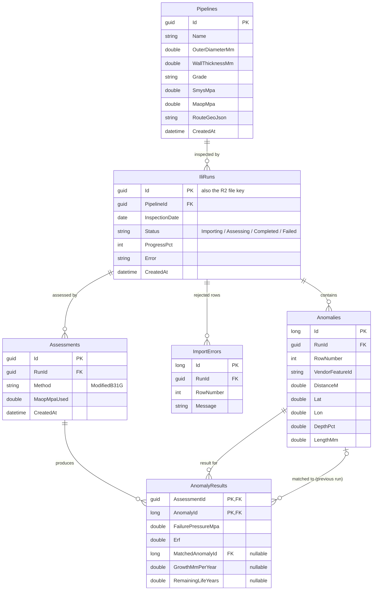
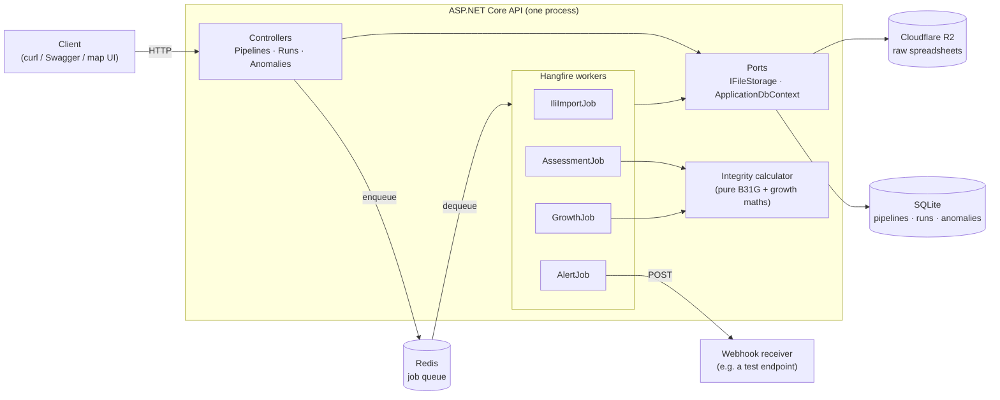
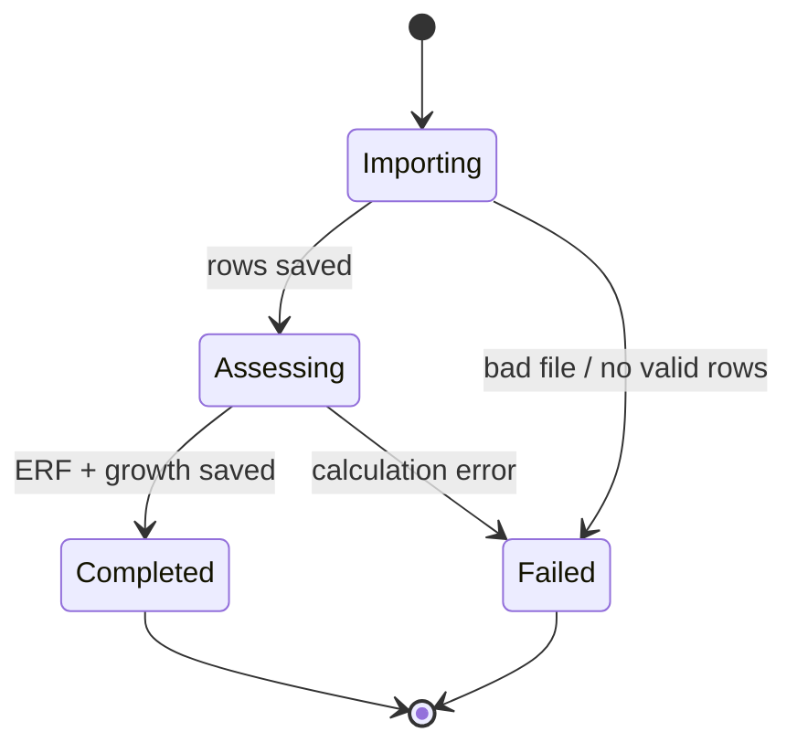

# Study project: Pipeline Integrity API

The next thing we build on top of this API. It takes the upload → background job → poll → GeoJSON flow we already have and puts a real engineering problem inside it, in place of the fake 60-second delay.

## The problem in plain terms

Oil and gas travel through steel pipes that run for hundreds of kilometres. Over time the steel **corrodes**, and pits form where the wall gets thinner. A thin spot can burst if the pressure inside is too high.

To find these spots, operators send a robot called a **pig** through the pipe. It measures the wall as it goes. The inspection company then sends back a spreadsheet with one row per defect (an **anomaly**):

| Column | Meaning |
|---|---|
| `distance_m` | How far along the pipe the defect is (also called *chainage*) |
| `lat`, `lon` | Where it is on the map |
| `depth_pct` | How deep the pit is, as a % of the wall thickness |
| `length_mm` | How long the pit is along the pipe |

An engineer needs answers to three questions:

1. **Is this defect dangerous right now?**
2. **How fast is it getting worse?**
3. **When must we dig it up and repair it?**

Our API answers them automatically for every defect in the file.

## Words you'll see

| Term | Meaning |
|---|---|
| **OD** (`D`) | Outside diameter of the pipe, in mm |
| **WT** (`t`) | Wall thickness, in mm |
| **SMYS** | How strong the steel is (Specified Minimum Yield Strength), in MPa. Comes from the steel grade, e.g. X52 = 359 MPa, X65 = 448 MPa |
| **MAOP** | The highest pressure the pipe is allowed to run at (Maximum Allowable Operating Pressure), in MPa |
| **ILI run** | One pass of the pig, i.e. one uploaded spreadsheet |
| **ERF** | Estimated Repair Factor. A score where **≥ 1 means "repair needed"** |

## The maths (just functions, no engineering background needed)

We use **Modified ASME B31G**, an industry-standard formula. Given a pipe (`D`, `t`, `SMYS`) and a defect (depth `d` in mm, length `L` in mm):

```
flowStress = SMYS + 69                              // MPa
z          = L² / (D · t)
M          = z <= 50 ? sqrt(1 + 0.6275·z − 0.003375·z²)
                     : 0.032·z + 3.3                // "bulging factor"
failStress = flowStress · (1 − 0.85·d/t) / (1 − 0.85·(d/t) / M)
failPressure = 2 · failStress · t / D              // pressure that bursts the pipe
safePressure = failPressure · 0.72                  // safety factor
ERF          = MAOP / safePressure                  // ≥ 1 → repair
```

When we have **two ILI runs** of the same pipe, a few years apart:

```
growthRate    = (depthNow − depthBefore) / yearsBetween      // mm per year
remainingLife = (0.8·t − depthNow) / growthRate              // years until 80% wall loss
```

> Unit test these first. They are pure functions with no database and no HTTP, so they're the easiest place to start.

## What we'll build

**Entities:** `Pipeline` (D, t, grade, MAOP, route) → `IliRun` (date, file, status) → `Anomaly` (distance, location, depth, length, ERF, growth rate, remaining life).

| Method | Route | Does |
|---|---|---|
| `POST` | `/pipelines` | Register a pipeline and its properties |
| `POST` | `/pipelines/{id}/runs` | Upload an ILI spreadsheet. Returns a run ID straight away (like today's `/File`) |
| `GET` | `/runs/{id}/status` | Poll: processing / completed / failed |
| `GET` | `/pipelines/{id}/anomalies?minErf=1&fromM=&toM=` | Filter defects by danger level or by stretch of pipe |
| `GET` | `/pipelines/{id}/anomalies.geojson?bbox=` | Defects as a GeoJSON map layer |
| `GET` | `/pipelines/{id}/digs` | Repair list, sorted by most urgent |

## Database design

### Tables



| Milestone | Tables added |
|---|---|
| 1 | `Pipelines`, `IliRuns`, `Anomalies`, `ImportErrors` |
| 2 | `Assessments`, `AnomalyResults` (ERF only) |
| 4 | The growth columns on `AnomalyResults` |
| 5 | `AuditLog` (`Id, At, User, Action, EntityId, Details`), append-only |

### Guidelines

1. **Keep inputs and results separate.** `Anomalies` holds exactly what the file said and is never updated. Calculated values go in `AnomalyResults`. If the formula has a bug, or the MAOP changes, you create a new `Assessment` and old results are kept. Overwriting would erase the history that regulators ask for.
2. **Put the unit in the column name**: `WallThicknessMm`, `MaopMpa`, `DistanceM`. Unit mix-ups (mm vs inches, MPa vs psi) are a classic engineering bug, and a name like `Thickness` hides them.
3. **Store values that are copied at the time.** `Assessments.MaopMpaUsed` records the MAOP the calculation actually used. If someone edits the pipeline later, the old result still makes sense.
4. **Use foreign keys everywhere** and let the database enforce them. Deleting a run should cascade to its anomalies, errors and assessments.
5. **Index what you filter and sort on.** Add each index when an endpoint needs it, and say which query it serves:
   - `Anomalies (RunId, DistanceM)`: chainage-range queries, and matching between runs
   - `AnomalyResults (AssessmentId, Erf DESC)`: the dig list
   - `IliRuns (PipelineId, InspectionDate)`: "find the previous run"
6. **Pick key types on purpose.** Use GUIDs for things clients see and share (pipelines, runs). They're safe to expose and work as storage keys, as today. Use auto-increment `long` for the large internal tables (anomalies), because the keys are smaller and inserts are faster.
7. **Record bad rows instead of failing the whole file.** One bad row out of 50,000 goes into `ImportErrors` with its row number. Fail the run only if no rows are valid, or if more than a set threshold are bad.
8. **Store status as text, not a number.** `"Completed"` is readable when you open the database by hand. In EF Core, use `.HasConversion<string>()`.
9. **`double` is fine here.** Unlike money, engineering values are already measurements with error. Round only when displaying.
10. **Insert in batches.** Don't call `SaveChanges()` once per row: 50,000 round trips is slow. Add about 1,000 rows, save, clear the change tracker, and repeat.

## System architecture

The same building blocks as today's API, with new jobs and a pure calculation module added. Arrows point from the caller to what it depends on.



**Rules to keep the design clean:**

- **Controllers stay thin.** They validate the request, save a row, enqueue a job and return. They never do the maths.
- **The calculator is pure.** No database, no HTTP, no files: numbers in, numbers out. That makes it easy to unit test, and it's the code that has to be right.
- **Jobs coordinate the work.** They load data through the ports, call the calculator, and save the results.
- **Each job does one step and then enqueues the next.** If one step fails, you can see where in the Hangfire dashboard.

## Data flow

What happens from upload to results, for one ILI run:


The run's status moves through these states:



Each failure stores an error message, just like `Geometry.Status = Failed` does today.

## Milestones, and what each one teaches

| # | Build | Backend concept you learn |
|---|---|---|
| 1 | Pipelines + ILI upload, reusing `ExcelProcessingJob` and `IFileStorage` | Relational modelling, foreign keys, input validation with per-row error messages |
| 2 | B31G assessment job (replace `Task.Delay` with the real maths) | Background jobs doing real CPU work, batching large files, progress reporting, unit testing pure logic |
| 3 | Filtering, paging, GeoJSON map endpoint | Query design, pagination, database indexes, spatial queries |
| 4 | Compare two runs → growth rate + remaining life | Matching records between datasets (match by `distance_m` ± tolerance), keeping old results instead of overwriting them |
| 5 | Alert when ERF ≥ 1, audit log, user roles | Webhooks with retries, append-only logs, authentication and authorisation |

## Test data

There's no real pig data to download, so use `tools/generate_ili_data.py` to make some:

```bash
pip install openpyxl
python tools/generate_ili_data.py                  # 5,000 anomalies, runs 5 years apart
python tools/generate_ili_data.py --count 50000    # a big file, for testing batching (milestone 2)
```

It writes three files to `sample-data/` (git-ignored):

| File | Use it for |
|---|---|
| `pipeline.json` | The body for `POST /pipelines`: diameter, wall thickness, grade, MAOP, route as a GeoJSON `LineString`, and both inspection dates |
| `ili_run_1.xlsx` | The first upload. Columns: `feature_id, distance_m, lat, lon, depth_pct, length_mm` |
| `ili_run_2.xlsx` | The second upload, 5 years later. The same defects are deeper, and there are 5 % new ones |

Things the generator does on purpose, so the exercises are realistic:

- **Most defects are shallow.** 85 % are 5–30 % deep and only about 3 % are 60–80 % deep, so a good dig list is short.
- **Distances drift between runs**, by roughly ±0.3 m. The same defect never has exactly the same `distance_m` twice, so matching needs a tolerance.
- **Feature IDs differ between runs** (`A-000123` vs `B-000117`), as they do between real inspection vendors. You can't join on them.
- **The same `--seed` always gives the same files**, so everyone in the group can compare answers.
